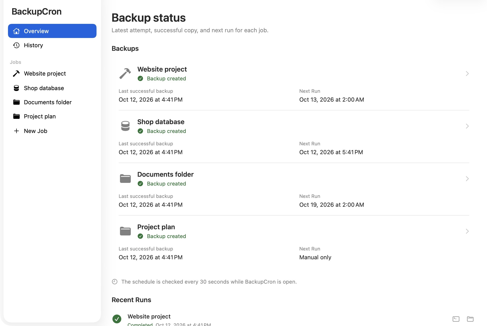
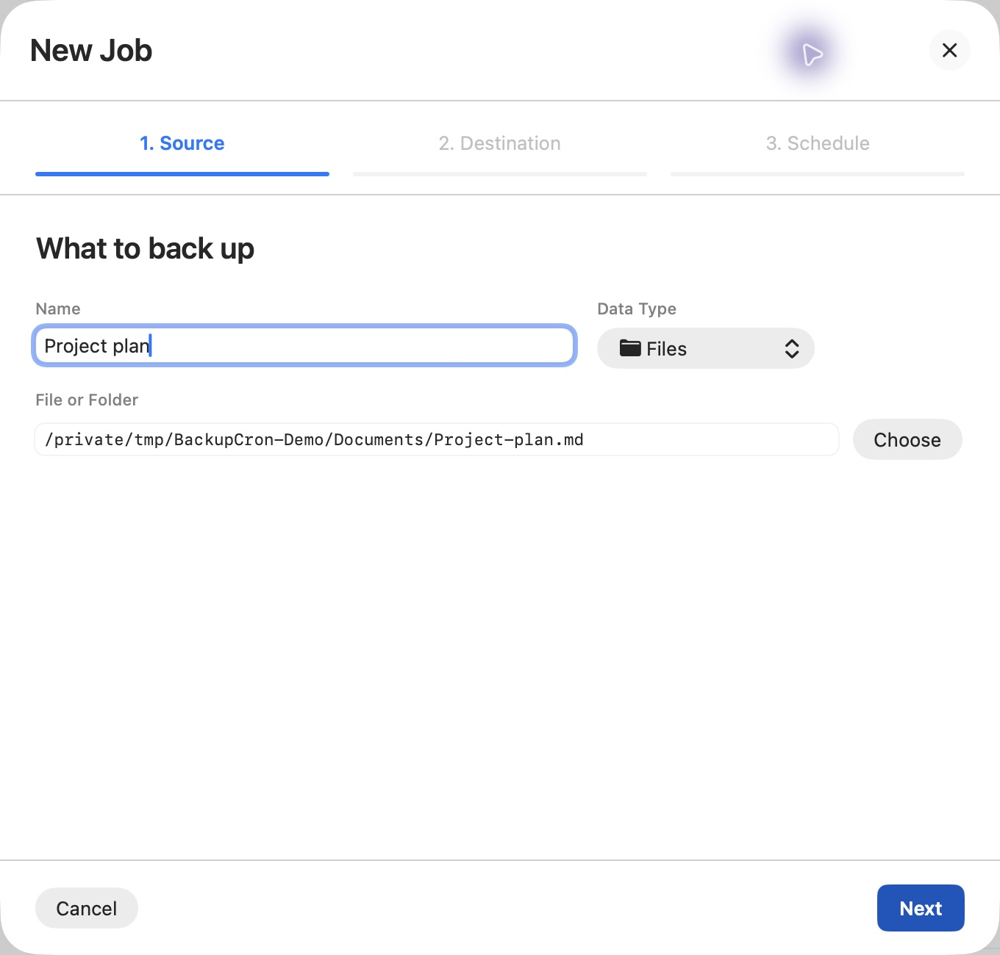
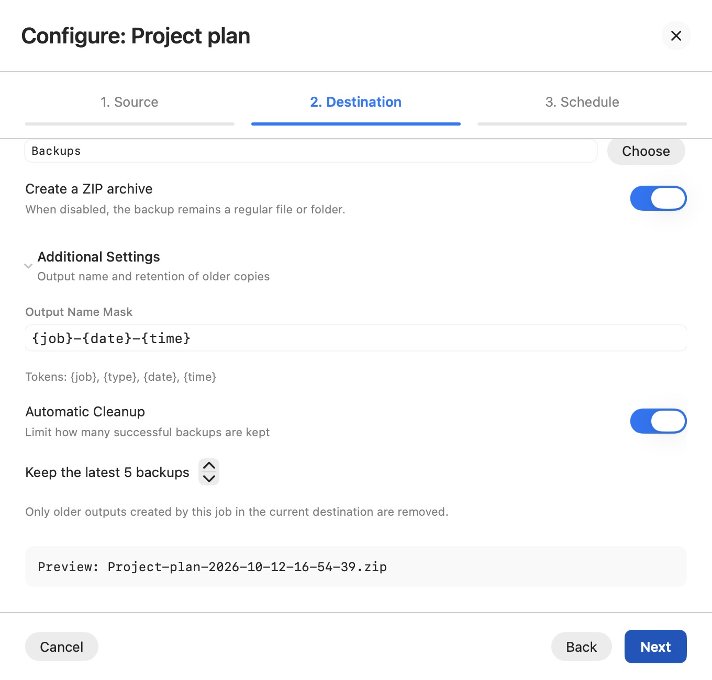
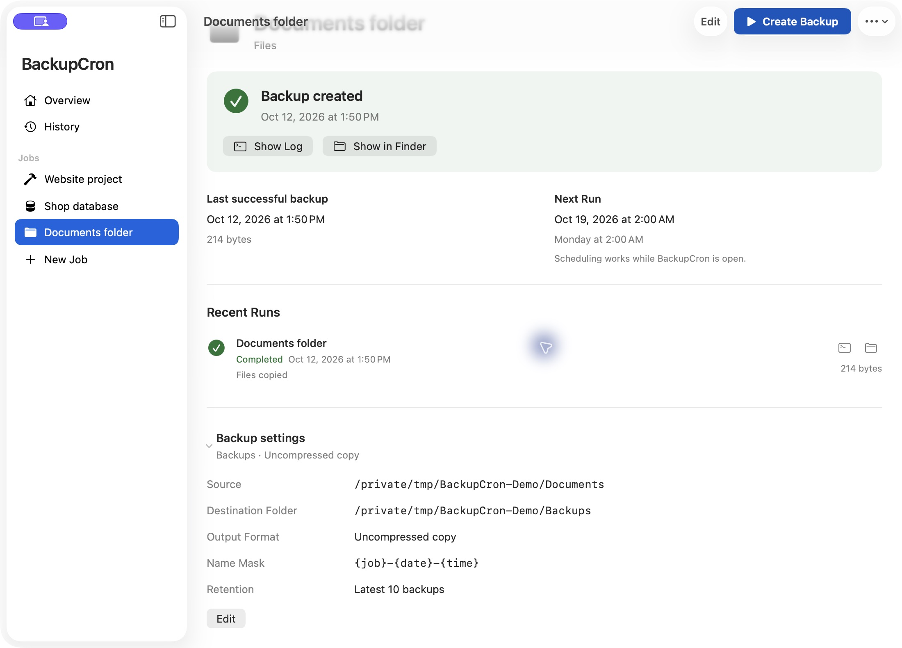
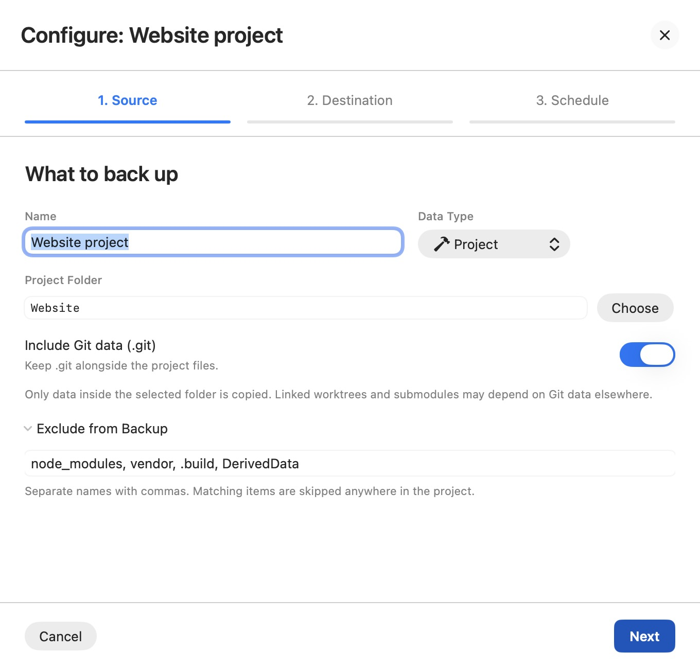
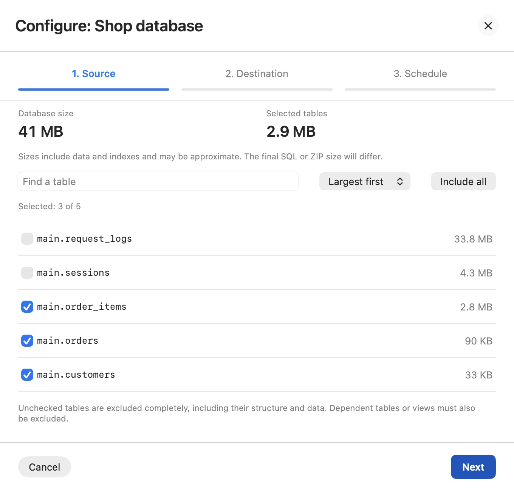

# BackupCron

A free, open-source native macOS app for scheduled backups of files,
projects and databases. All features are available without purchases,
subscriptions or a limit on the number of jobs.

## Screenshots

These screenshots use demo data. The successful backup results shown come from actual runs.



<details>
<summary>Files and folders: single file, ZIP settings and ordinary folder copy</summary>

Select an individual file or a folder as the source.



Choose ZIP output, a filename template and retention of the last five successful copies.



Keep a folder as an ordinary copy, with a recorded result and automatic retention.



</details>

<details>
<summary>Projects: include Git and exclude dependency folders</summary>

Keep the project's Git data and skip generated dependencies such as `node_modules`.



</details>

<details>
<summary>Databases: inspect table sizes before choosing exclusions</summary>

This SQLite example keeps customers and orders while excluding request logs and sessions completely.



</details>

## Features

- Files, folders and projects: ordinary copies or ZIP archives.
- SQLite: consistent snapshots, with optional removal of entire tables.
- PostgreSQL and MySQL: SQL dumps using their native command-line clients.
- Database table sizes, search and sorting before choosing exclusions.
- Dependency checks for excluded tables and views, and a disk space estimate.
- Direct, Docker and SSH database connections, SSL and connection checks.
- Manual runs, intervals, hourly, daily and weekly schedules.
- Filename templates and optional retention of the last N successful copies.
- Project exclusions and an explicit option to include Git metadata.
- Progress, live logs, history, notifications and optional sound feedback.
- Cancellation that removes unfinished results; verified outputs are published
  without overwriting existing backups.
- Database passwords in macOS Keychain and persistent access to selected paths.
- Ten interface languages, selected from the macOS language settings.

## Requirements

- macOS 14 or later.
- Swift 6.1 or newer for building from source; available with Xcode 16.3 or newer.
- PostgreSQL/MySQL command-line clients for direct database backups.
- Docker for container connections, or configured SSH key authentication for SSH.

SQLite and ZIP operations use the tools included with macOS.

## Build and run

```sh
git clone https://github.com/backupcron/backupcron.git
cd backupcron
zsh scripts/build-app.sh
open .build/BackupCron.app
```

The script creates `.build/BackupCron.app` and `.build/BackupCron.zip`, and
checks the signature after unpacking the ZIP. Use the ZIP when transferring
the build: cloud-synced folders can add metadata to an app bundle.

You can also open `Package.swift` or `BackupCron.xcodeproj` in Xcode, or run:

```sh
swift run
```

System notifications are available in a packaged `.app`; `swift run` disables
them. The Xcode app target uses App Sandbox, so external database tools and
Docker access need to be tested separately in that build.

The script and CI produce ad hoc signed development builds. For public
downloads that pass the standard macOS distribution checks, release maintainers
need Developer ID signing and Apple notarization. See
[Apple's distribution documentation](https://developer.apple.com/developer-id/).

## Backup behavior

The schedule is checked every 30 seconds while BackupCron is open. Enable
launch at login if you want the app to start with your Mac. Scheduled jobs
run while the app is running and the source is accessible.

Tables without a checkmark are excluded completely, including their structure
and data. Dependent tables and views must also be excluded. SQLite first takes
a complete snapshot, then rebuilds the private copy while preserving row IDs
and validating retained data. Its temporary space requirement therefore
depends on the full database, even when only a few tables are retained.

Table sizes include data and indexes where available. SQL and ZIP sizes are
estimates. Unknown sizes are shown explicitly. Existing jobs can be edited
without connecting when the database connection and exclusions are unchanged;
the engine checks exclusions again when the job runs.

In SSH mode, database tools run on the server and use its `.pgpass` or `.my.cnf`.
The local Keychain password is not transmitted in this mode.

New project jobs include `.git`. Worktrees, submodules and external Git object
stores may depend on paths outside the project folder. A project copy is not
an atomic Git snapshot and does not include a separate database automatically.

## Tests

```sh
swift test
```

Tests use temporary files and disposable fixtures. CI runs the tests and
packages a development build on macOS. Database integration tests are opt-in.

### Database integration tests

Use disposable containers in the Docker context `desktop-linux`, labelled
`com.backupcron.integration=true`. PostgreSQL uses the user `backupcron`,
MySQL uses `root`, and both fixtures use the password
`backupcron-disposable-fixture`. No host ports are needed: tests connect
inside the containers with `docker exec`.

For PostgreSQL, initialise with
`POSTGRES_INITDB_ARGS=--auth-host=scram-sha-256 --auth-local=trust` to exercise
TCP password authentication as well as successful restoration.

```sh
BACKUPCRON_TEST_POSTGRES_CONTAINER=backupcron-test-postgres \
BACKUPCRON_TEST_MYSQL_CONTAINER=backupcron-test-mysql \
swift test
```

Use only containers created for this purpose and remove them after testing.
Without these environment variables the live database tests are skipped.

## Contributing

Bug reports, improvements and translations are welcome. See
[CONTRIBUTING.md](CONTRIBUTING.md).

## Support the author

If BackupCron helps you, you can thank the author by starring the repository,
sharing the project, reporting a useful issue or contributing an improvement.
Support is voluntary. All features remain free for everyone.

For a voluntary donation in Bitcoin (BTC, Bitcoin network):

```text
bc1qvc6l4tk53ekg4jhw9chh863stq7m36mxjvsnud
```

For a voluntary donation in Ether (ETH, Ethereum network):

```text
0x2E68cc76dE05A3099E68493872ab337346f1459D
```

For a voluntary donation in Solana (SOL, Solana network):

```text
8vzCVjEscG1Va7wPCWZzAirwjj8SNxKKV65ZPZ2Yy6fp
```

## License

BackupCron is available under the [MIT license](LICENSE).

---

BackupCron — бесплатное приложение с открытым исходным кодом для macOS.
Все возможности доступны без покупок и ограничения количества заданий.
Если проект полезен, можно добровольно поблагодарить автора звездой на GitHub,
отзывом или вкладом в развитие проекта.
